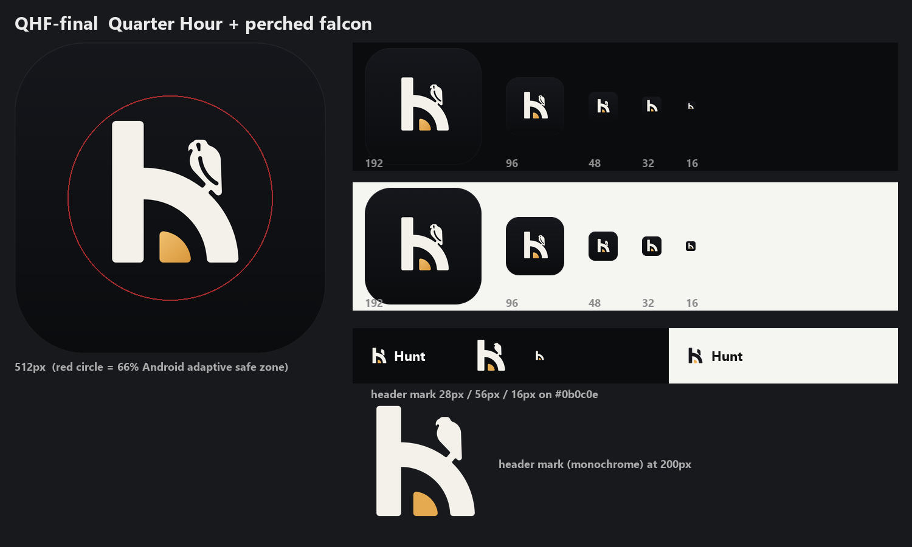
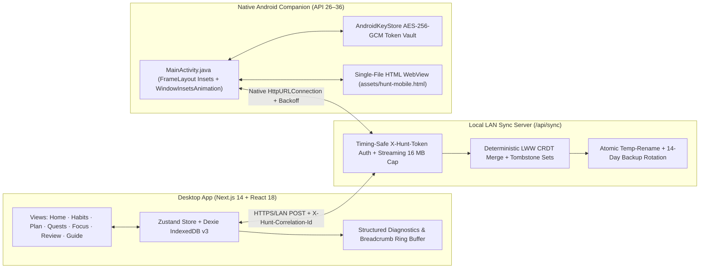

<p align="center">
  
</p>

<h1 align="center">Hunt</h1>

<p align="center">
  <strong>Local-first single-task focus, daily habits, and weekly quest telemetry across Desktop and native Android — synchronized over LAN via a deterministic CRDT merge engine with zero cloud dependency.</strong>
</p>

<p align="center">
  
  
  
  
</p>

---

## Overview

Hunt is built for deep-work practitioners who want calm, single-task execution instead of crowded Kanban boards or cloud-tethered SaaS subscriptions. You define up to three active **Quests** with weekly hour targets, schedule **Tasks** and recurring **Daily Habits**, lock into a distraction-free **Focus** timer, and review real **Done-List Telemetry** across your week.

All data lives locally on your devices — IndexedDB (Dexie) on desktop and atomic JSON files on Android — and converges automatically over your local Wi-Fi or Tailscale network through an authenticated `/api/sync` merge server.

<!-- Visual Proof: Add desktop and mobile screenshots to docs/screenshots/ and reference them here -->
<p align="center">
  
</p>

---

## System Architecture



### Engineering Highlights

- **Clock-Independent CRDT Sync & Crash-Safe Storage:** [`src/lib/syncTypes.ts`](src/lib/syncTypes.ts) and [`src/app/api/sync/route.ts`](src/app/api/sync/route.ts) implement a commutative, associative, idempotent last-write-wins merge over quests, tasks, habits, time logs, and bounded tombstone sets — verified across 400-seed property tests in [`syncProperties.test.ts`](src/__tests__/syncProperties.test.ts). Writes use temp-file + atomic rename with automatic rollback recovery across main, backup, and 14-day snapshots.
- **Deterministic Offline Daily Habits:** Daily habits materialize into per-day tasks using deterministic IDs (`habtsk-<YYYY-MM-DD>-<habitId>`), allowing laptop and phone to materialize identical tasks independently offline and converge without duplicate rows upon reconnect.
- **Zero-Gradle Direct Android Build & Hardened WebView Shell:** [`android-app/build-apk.sh`](android-app/build-apk.sh) compiles and signs the Android companion directly with `aapt2`, `javac`, `d8`, `zipalign`, and `apksigner` (verifying the pinned signing certificate and scanning for leaked secrets). [`MainActivity.java`](android-app/app/src/main/java/com/hunt/companion/MainActivity.java) stores pairing tokens exclusively in AndroidKeyStore AES-256-GCM envelopes, locks WebView navigation to an explicit origin allowlist, and drives smooth Android 11+ IME bottom-sheet motion via `WindowInsetsAnimation.Callback` inside a safe-area-padded `FrameLayout`.
- **Structured Observability & Root-Cause Diagnostics:** [`src/lib/diagnostics.ts`](src/lib/diagnostics.ts) propagates `X-Hunt-Correlation-Id` end-to-end across desktop, `/api/sync`, and mobile, records `durationMs` I/O telemetry, maintains bounded circular breadcrumb flight recorders, wires global unhandled fault traps (`error` / `unhandledrejection`), and recursively redacts bearer tokens and 64-hex keys (`[REDACTED]`).
- **Adversarial Security & Chaos Test Suite:** 28 Vitest suites (980 tests) exercise boundary inputs, XSS/prototype-pollution/timing-safe auth pentesting ([`syncRouteSecurity.test.ts`](src/__tests__/syncRouteSecurity.test.ts), [`mobileSecurity.test.ts`](src/__tests__/mobileSecurity.test.ts)), 300-seed payload sanitizer fuzzing, 400-step random store fuzzing, Europe/Berlin DST rollover fuzzing, WCAG AA contrast ratios, and JDK compilation of `MainActivity.java` helpers.

---

## Project Structure

```text
.
├── src/
│   ├── app/
│   │   ├── api/sync/route.ts       # Authenticated CRDT merge API + atomic backup store
│   │   ├── layout.tsx              # Root shell, typography, icons & 100dvh layout
│   │   └── page.tsx                # View router, boot pipeline & global fault traps
│   ├── components/                 # Home, Habits, Plan, Quests, Focus, Review, Guide & Sync UI
│   ├── lib/
│   │   ├── db.ts                   # Dexie IndexedDB v3 schema, DST-safe dates & formatters
│   │   ├── diagnostics.ts          # Structured logging, redaction, breadcrumbs & fault traps
│   │   ├── hudAudio.ts             # Persisted-mute Web Audio feedback chimes
│   │   ├── syncEngine.ts           # Client diff-apply, AbortController timeout & tombstones
│   │   └── syncTypes.ts            # Strict runtime schema validators & LWW CRDT merge
│   ├── store/useCommandStore.ts    # Zustand state machine, focus sessions & habit engine
│   └── __tests__/                  # 28 test suites (980 unit, property, fuzz & security tests)
├── public/
│   └── hunt-mobile.html            # Self-contained mobile web & Android WebView UI
├── android-app/
│   ├── build-apk.sh                # Direct aapt2/javac/d8/apksigner APK build + verification
│   └── app/src/main/
│       ├── AndroidManifest.xml     # Least-privilege permissions & backup exclusion rules
│       ├── assets/hunt-mobile.html # Byte-identical mirror verified by mobileMirror.test.ts
│       └── java/com/hunt/companion/MainActivity.java
├── brand/logo/                     # Vector logo marks and icon contact sheets
├── Start-Hunt.bat                  # Windows standalone app-mode launcher
├── Start-Server.bat                # Production/dev server bootstrapper
└── .env.example                    # Optional runtime environment variables
```

---

## Quickstart

### Prerequisites

- **Node.js** 18+ and **npm**
- *(Optional, for Android APK builds)* **JDK 11+** and **Android SDK** (`build-tools` + `platforms` + `adb`)

### Installation

```bash
git clone https://github.com/Andreas-Erick/Hunt.git
cd Hunt
npm install
```

*(Optional)* Copy `.env.example` to `.env.local` if you want to customize `HUNT_DATA_DIR` or `LOG_LEVEL`.

### Running Locally

**Development mode:**

```bash
npm run dev
```

**Production build & server:**

```bash
npm run build
npm run start
```

Open `http://localhost:3000` in your browser. On Windows, you can also run `Start-Hunt.bat` to launch Hunt in a standalone desktop app window.

### Running Tests & Typechecking

```bash
npm test
npx tsc --noEmit
```

All 28 test suites (980 tests) are deterministic and hermetic (virtual clocks, seeded PRNGs, `fake-indexeddb`, and isolated temp directories).

### Building & Installing the Android Companion APK

1. Ensure `public/hunt-mobile.html` and `android-app/app/src/main/assets/hunt-mobile.html` are synced (enforced automatically by `mobileMirror.test.ts` and `build-apk.sh`).
2. Build and verify the signed APK:

```bash
bash android-app/build-apk.sh "./android-app" "./Hunt-Mobile.apk"
```

3. Install in-place over ADB without wiping existing phone data:

```bash
adb install -r "./Hunt-Mobile.apk"
```

Pair the phone once by opening **Phone & Sync** on desktop and scanning/entering the local LAN URL and pairing token stored in `data/hunt-sync.key`.
