<p align="center">
  <picture>
    <source media="(prefers-color-scheme: dark)"
      srcset="brand/logo/hunt-readme-dark.svg" />
    <source media="(prefers-color-scheme: light)"
      srcset="brand/logo/hunt-readme-light.svg" />
    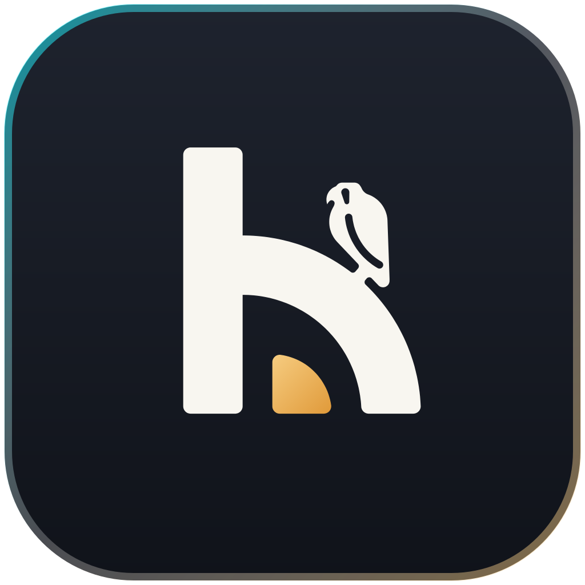
  </picture>
</p>

<h1 align="center">Hunt</h1>

<p align="center">
  Local-first focus timer, daily habits and weekly quests for
  one person. Runs on a Windows desktop and an Android phone,
  syncs over your own Wi-Fi, and needs no account or cloud.
</p>

<p align="center">
  <a href="https://github.com/Andreas-Erick/Hunt/actions/workflows/ci.yml"></a>
  
  
  
  
</p>

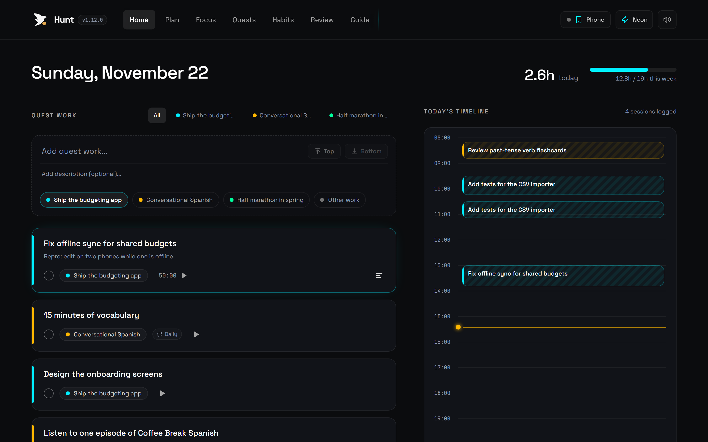

<p align="center">
  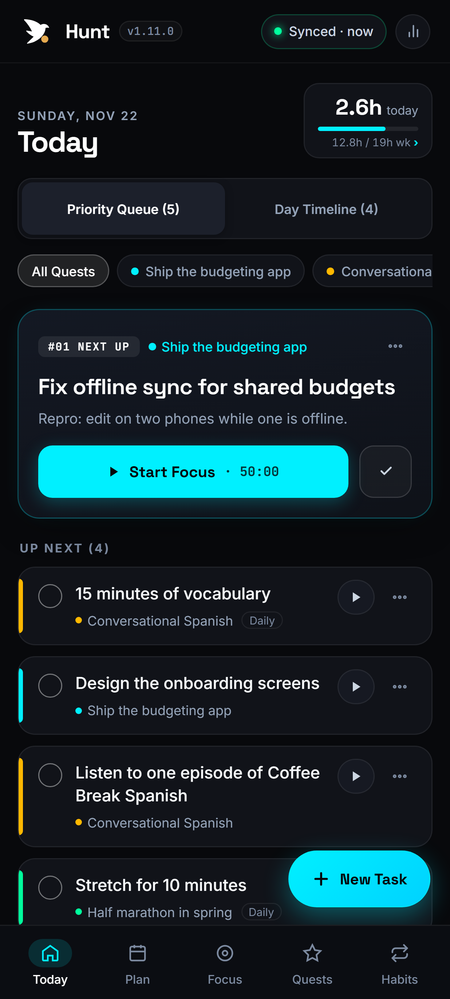
  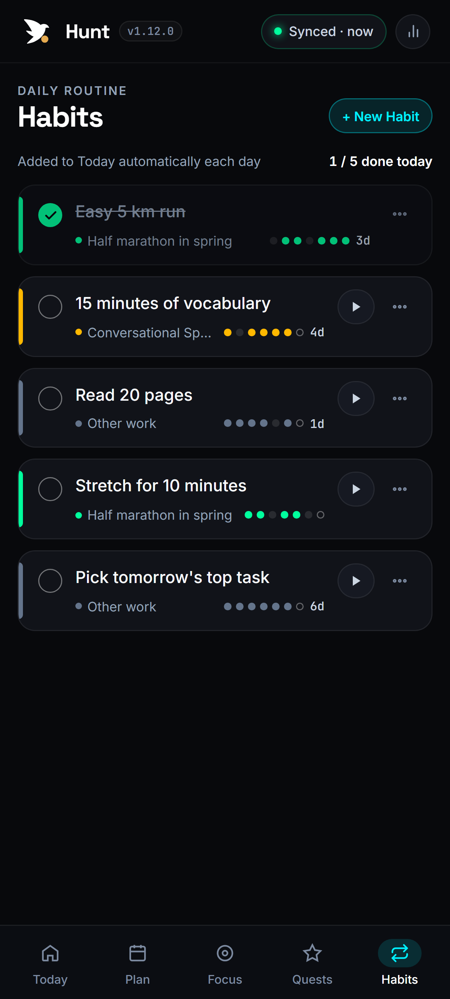
</p>

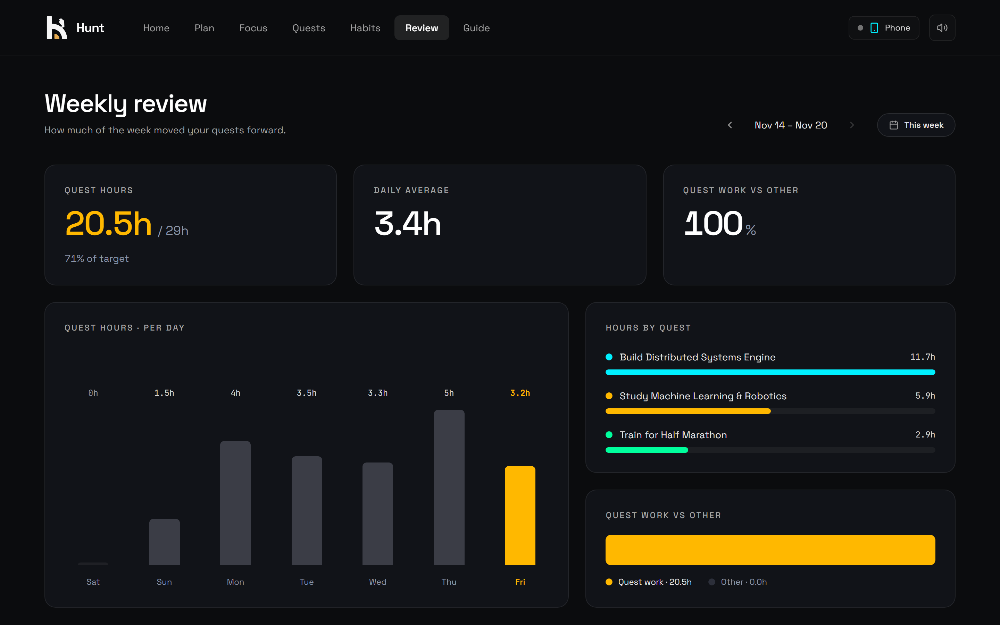

<details>
<summary><b>More screenshots</b></summary>

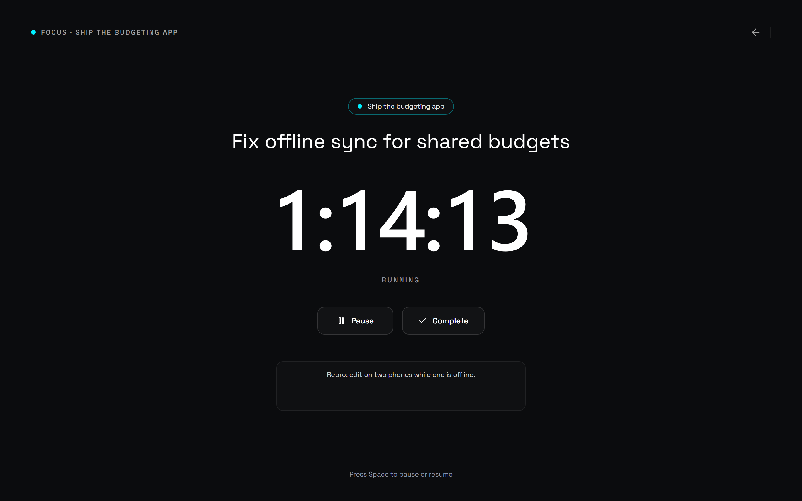
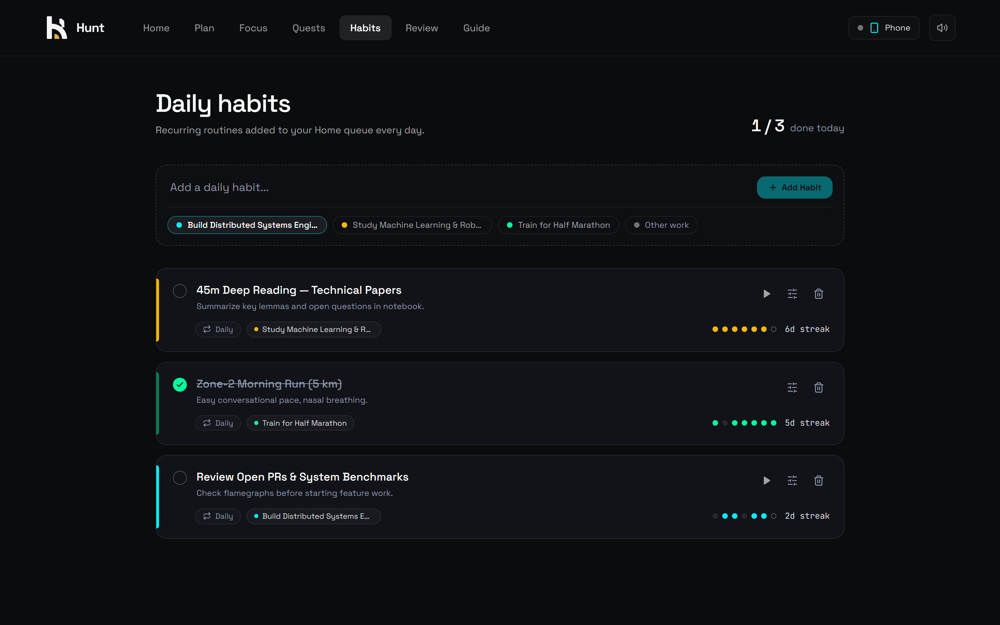

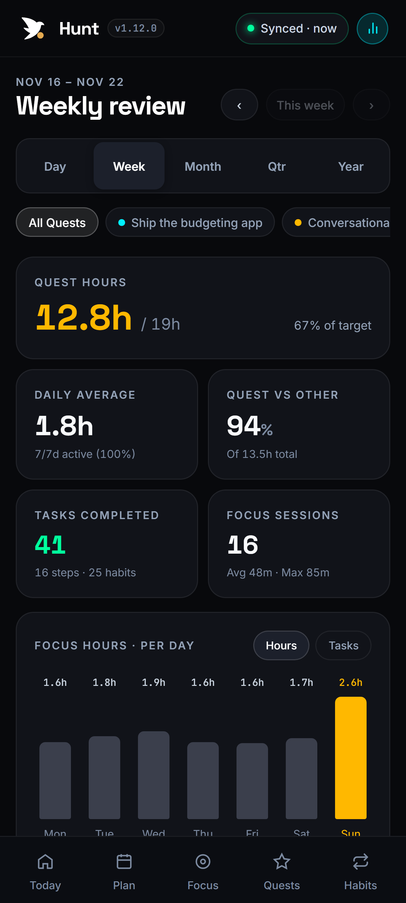

</details>

## What it does

You pick up to three **quests** with weekly hour targets,
queue **tasks** and daily **habits** under them, work on one
task at a time in **Focus**, and see where the hours went in
**Review** (day to year, plus an activity heatmap).

Habits come in three kinds: done-or-not, **counted**
(glasses of water, toward a daily number), or things to
**avoid**, where a Slip is logged instead of a tick. Each
habit has a Habit Score and a Success Rate. Tasks and
habits can carry **reminders** that fire on both the
desktop and the phone; on the phone, a notification's
Done, +1 and Snooze work without opening Hunt.

The desktop app keeps its data in IndexedDB. The phone keeps
an atomic JSON file through its Android shell. When both are
on the same network (or Tailscale), they converge through a
small sync server that runs inside the desktop app.

On Android, two optional home-screen widgets work without
opening the app. The **Day Widget** lists the open tasks
for today or any of the next six days, and ticks one done
with a 4-second Undo. Hunt applies the tick the next time
it runs. The **Stats Widget** shows each quest's hours over
the last seven days against its target, today's focus time
and habit streaks. Both follow the device's look.

Two looks ship with it: **Neon** (the original) and **Dawn**
(blue-hour colours, a serif clock and a sun that crosses the
Focus screen once an hour). Each device remembers its own
choice. On the desktop the switch is in the top bar; on the
phone it is in the Laptop sync sheet.

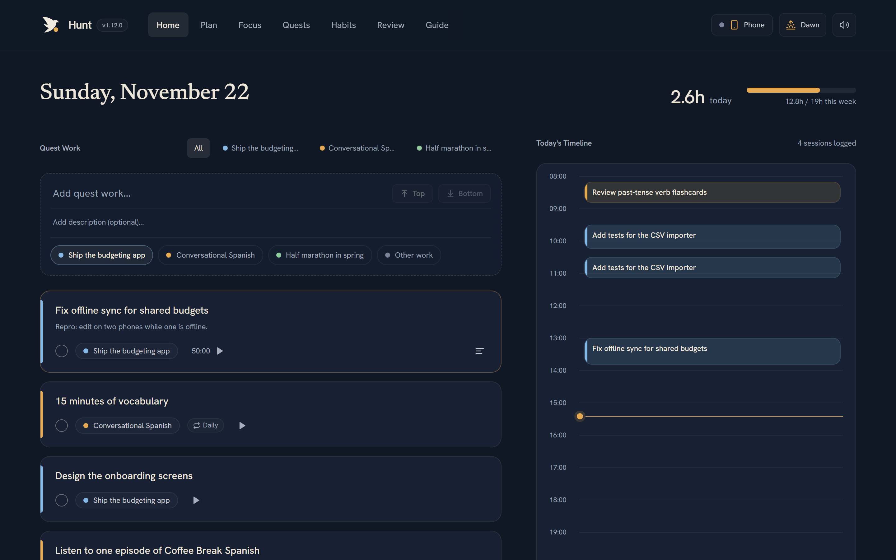

<p align="center">
  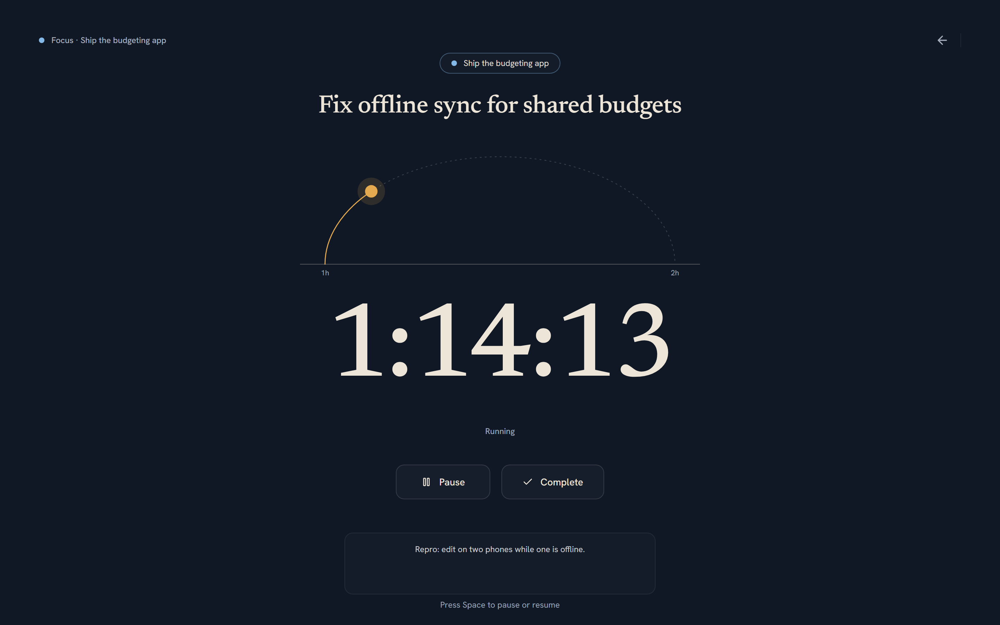
  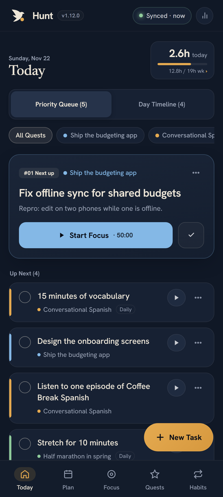
</p>

## Goals

- **One person, several devices, no account.**
- **Offline first.** Every device works on its own; sync
  only converges state and is never needed to use the app.
- **Merges can't depend on order.** The merge is
  commutative, associative and idempotent, checked by a
  400-seed property test.
- **Never overwrite data that can't be read.** The server
  and the phone keep a copy of an unreadable file before
  anything replaces it, and the server returns HTTP 507
  rather than merge over files it can't read at all.
- **Touch-first.** 44px targets on touch screens; layout is
  tested in a real browser from 360px to 2560px wide.

## Non-goals

- Multiple users, sharing, or permissions.
- Cloud hosting or sync over the public internet
  (use Tailscale for remote access).
- Real-time co-editing or character-level merges.
- iOS, or Play Store distribution.

## Architecture

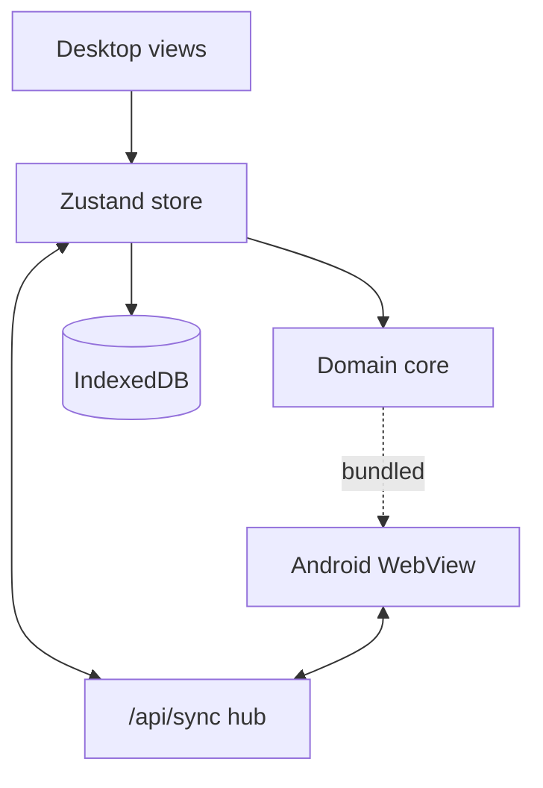

These dependency rules are enforced by
[`architectureTopology.test.ts`](src/__tests__/architectureTopology.test.ts):

- No import cycles, including type-only imports.
- Domain modules (`syncTypes`, `focusSession`,
  `reviewAnalytics`, `habitDay`, …) never import React,
  Dexie or the store.
- Views never import the database module. Reads go
  through `lib/reads.ts`, writes through the store.

The phone doesn't reimplement the rules. The same
TypeScript (merge, focus state machine, burst logs, habit
rows) is bundled into it by
[`build-mobile-core.mjs`](scripts/build-mobile-core.mjs).
One test fails if that copy is stale, and another drives the
phone's focus buttons against the desktop modules step by
step.

<details>
<summary><b>Where things live</b></summary>

- `src/lib/` — domain core, sync contract, analytics
- `src/store/` — Zustand store and habit engine
- `src/components/` — desktop views
- `src/app/api/sync/` — sync hub, atomic file, backups
- `src/mobile/` — entry point of the phone bundle
- `public/hunt-mobile.html` — the phone app (one file)
- `android-app/` — WebView shell and APK build script
- `e2e/` — Playwright layout tests, 360–2560px
- `e2e-web/` — smoke test of the browser demo
- `installer/` — Inno Setup script for Windows
- `docs/adr/` — design decisions

</details>

## Design decisions

| ADR | Decision | Trade-off |
| --- | --- | --- |
| [0001](docs/adr/0001-row-level-lww-merge.md) | Row-level LWW merge | Clock skew picks winners |
| [0002](docs/adr/0002-laptop-as-sync-hub.md) | Laptop is the hub | No sync while it's off |
| [0003](docs/adr/0003-single-file-phone-app.md) | One-file phone app | Types stop at HuntCore |
| [0004](docs/adr/0004-direct-apk-build.md) | No-Gradle signed APK | Custom build script |
| [0005](docs/adr/0005-two-looks.md) | Two looks, one token set | Looks aren't synced |
| [0006](docs/adr/0006-widget-pending-ticks.md) | Widget ticks are queued | Applied when Hunt runs |
| [0007](docs/adr/0007-reminders-on-both-devices.md) | Reminders fire on both devices | Duplicates until sync |
| [0008](docs/adr/0008-habit-days-are-task-rows.md) | Habit days are Task rows | Id format is frozen |
| [0009](docs/adr/0009-desktop-window-control-route.md) | Window control via a local route | Window buttons Windows-only |
| [0010](docs/adr/0010-static-browser-demo.md) | Static browser demo from the same app | No sync; base path is build-time |

## Quickstart

Needs Node 22 or newer (CI uses the version in `.nvmrc`).

```bash
git clone https://github.com/Andreas-Erick/Hunt.git
cd Hunt
npm ci
npm run dev        # http://localhost:3000
```

On Windows, `Start-Hunt.bat` opens Hunt in its own app
window. Optional settings (`HUNT_DATA_DIR`, `LOG_LEVEL`) are
listed in [`.env.example`](.env.example).

## Run in the browser

A static build of the desktop app runs in any browser as a
live demo, with sample data and no server:

```bash
npm run build:web     # static files in out/
npm run preview:web   # http://localhost:4173/demos/hunt/
```

It is built for `/demos/hunt/`. To serve it from another
path, set `HUNT_WEB_BASE_PATH` (for example `/hunt`) before
both commands. `http://localhost:4173/` embeds the demo in
an iframe so you can check it from 360px to 1280px.

Data stays in the browser (IndexedDB), and **Reset demo**
in the banner brings back the sample data. Sync, phone
pairing, notifications and the window buttons need the
real app, so the demo leaves them out. Each release attaches
the built folder as `hunt-web-demo.zip`. See
[ADR-0010](docs/adr/0010-static-browser-demo.md).

## Checks

```bash
npm run check          # lint, types, tests, build
npm run test:geometry  # Playwright, 360–2560px
npm run test:web-demo  # browser demo smoke test
```

`check` runs the same steps as CI's `verify` job. CI also
runs the geometry suite and builds the APK with a
throwaway key, each as its own job, and a separate
workflow builds and smoke-tests the browser demo on every
push. The 1,900+ Vitest
tests are hermetic: virtual clocks, seeded random inputs,
`fake-indexeddb`, and temp directories.

`npm install` also sets up a pre-push hook that runs
`npm run check`, so a failing commit never reaches GitHub.

<details>
<summary><b>Building the Android app</b></summary>

Needs a JDK and the Android SDK. Releases are signed with a
key kept in CI secrets, so a local build uses your own key:

```bash
keytool -genkeypair -keystore my.jks -alias hunt \
  -keyalg RSA -keysize 2048 -validity 10000

KEYSTORE=my.jks KEY_ALIAS=hunt KS_PASS=yourpass \
EXPECTED_CERT_SHA256=skip \
bash android-app/build-apk.sh ./android-app ./Hunt.apk

adb install -r ./Hunt.apk
```

An APK signed with a different key can't update an existing
install. Android makes you uninstall first, which deletes
the phone's data. See
[ADR-0004](docs/adr/0004-direct-apk-build.md).

To pair, open **Phone & Sync** on the desktop and scan the
QR code. To revoke a phone, delete `data/hunt-sync.key`. A
new key is created on the next request, and the old one
stops working at once.

</details>

<details>
<summary><b>Releases</b></summary>

Pushing a `v*` tag runs
[`release.yml`](.github/workflows/release.yml). It reruns
the tests, lint and typecheck. It stops if `package.json` or
the Android `versionName` doesn't match the tag. Then it
publishes:

- `Hunt-Desktop-Setup-<version>.exe`: Windows installer
  with a bundled Node.js runtime
- `Hunt-Desktop-Windows-<version>.zip`: portable bundle
- `Hunt-Mobile-<version>.apk`: signed Android app
- `hunt-web-demo.zip`: the browser demo's static files
- `SHA256SUMS.txt`

`npm run screenshots` regenerates `docs/screenshots/` from
the current build, using made-up demo data.

</details>

## License

[MIT](LICENSE)
